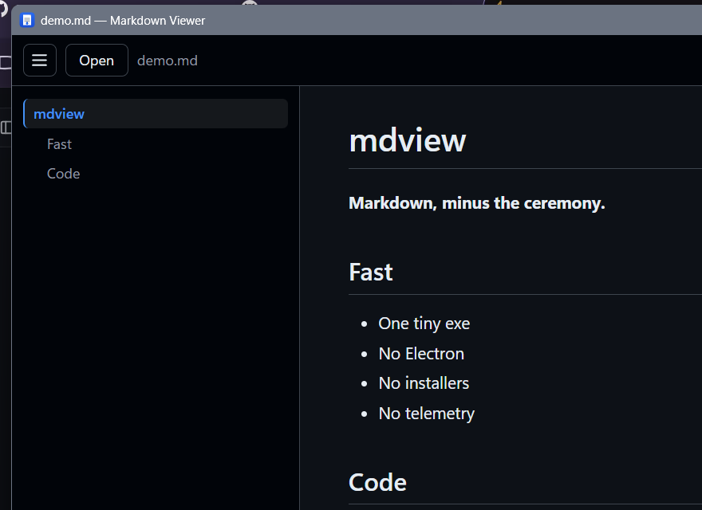

# mdview

**Markdown, minus the ceremony.**

A dead-simple Markdown viewer for Windows 11 dev machines. Drop a `.md` on it, or double-click one. It opens instantly, renders GitHub-flavored Markdown, and gets out of the way.



## Why it's small

- **One `mdview.exe`** (~450 KB).
- **No Electron. No Node. No installer. No telemetry.**
- Markdown parsed by [md4c](https://github.com/mity/md4c) (vendored, MIT).
- Rendered by **WebView2** — already part of Windows 11.
- Static CRT. No VC++ redistributable.

## No frills

No settings. No plugins. No account. No background daemons. Just a window, a file, and Markdown.

## Features

- Open, drag-drop, command-line arg, file associations
- GitHub-flavored Markdown: tables, task lists, strikethrough, autolinks
- Outline sidebar with scroll spy
- Syntax highlighting
- Live reload on file change
- Light/dark theme that follows Windows
- Relative images and links resolve against the file
- `.md` links open in-app; web links open in your browser

## Build

Requires Windows 11, **VS 2022 Build Tools** (Desktop development with C++), and CMake 3.20+.

```bat
build.bat
```

Output: `build\Release\mdview.exe`. The first configure downloads the WebView2 SDK (build-time only). md4c is vendored.

### From WSL / VS Code

```bash
./build.sh
```

`build.sh` mirrors the source to a writable Windows drive, runs `build.bat`, and copies the exe back to `build/win-x64/mdview.exe`. Override the mirror with `MDVIEW_WIN_DIR`. In VS Code, `Ctrl+Shift+B` runs the same task.

Prefer native Windows? Open the project in VS Code **Windows mode** and use the `windows-msvc` CMake preset.

## Use

```bat
build\Release\mdview.exe notes.md
```

Or just run it and hit **Open**. `install.ps1` registers `.md`, `.markdown`, `.mdown`, and `.mkd` (per-user, no admin).

## Keys

`Ctrl+O` open · `Ctrl+R` / `F5` reload · `Ctrl+B` outline · `Ctrl+0` reset zoom · `Ctrl+±` zoom

## License

MIT. md4c is MIT; see `third_party/md4c/LICENSE.md`.
